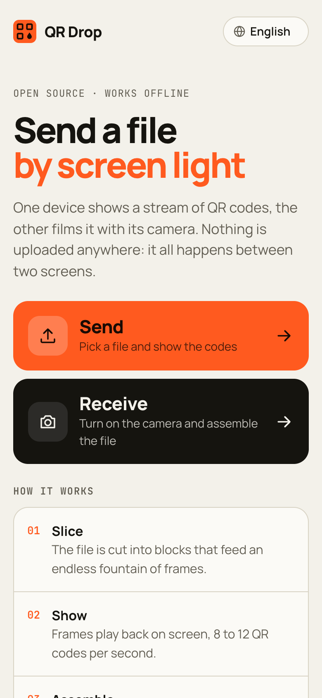
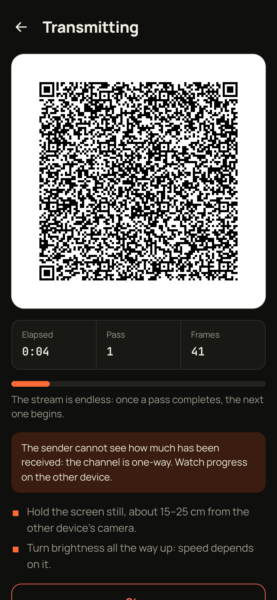
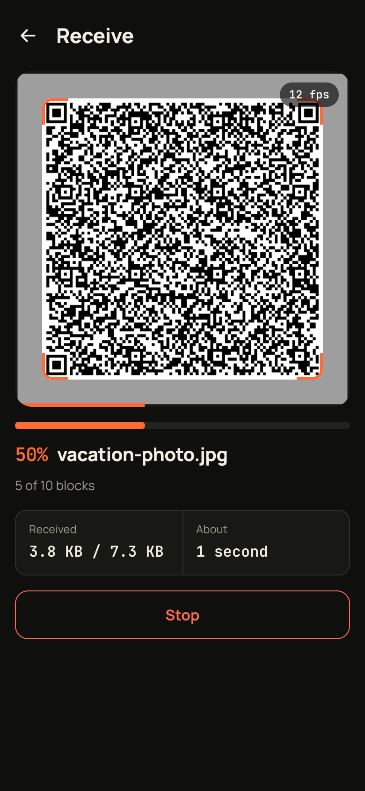
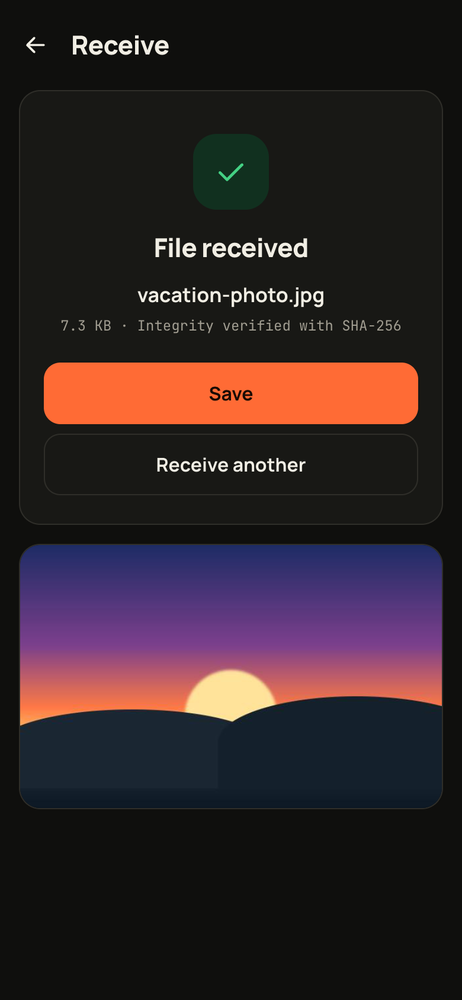

# QR Drop

[English](README.md) · [Русский](README.ru.md) · **中文** · [العربية](README.ar.md) · [Français](README.fr.md)

**通过一串二维码，把文件从一台设备传到另一台设备。** 一块屏幕循环播放无穷无尽的二维码，另一台设备用摄像头拍下来并拼回文件。无需服务器、无需网络、无需配对：只要一块屏幕和一个镜头。

**在线使用：** https://universe-coder.github.io/qr-drop/

[MIT 许可证](LICENSE)

<table>
  <tr>
    <td align="center"><br><sub>主页</sub></td>
    <td align="center"><br><sub>发送</sub></td>
    <td align="center"><br><sub>接收</sub></td>
    <td align="center"><br><sub>完成</sub></td>
  </tr>
</table>

```
file ──► blocks ──► fountain frames ──► QR ──► screen
                                                 │
                                              camera
                                                 ▼
file ◄── SHA-256 ◄── assembly ◄── frames ◄── jsQR
```

- 首次打开后即可离线使用（Service Worker），文件不会上传到任何地方。
- 发送在任何现代浏览器中都能用；接收需要摄像头和 HTTPS。
- 界面支持英语、俄语、中文、阿拉伯语（从右到左）和法语；提供浅色和深色主题。
- 内置自检（`#/selftest`）在浏览器中跑通除摄像头之外的整条流程。

## 为什么没有回传通道也能工作

接收方无法请求重发某一帧：根本没有传话的渠道。与此同时，摄像头会漏掉一半甚至更多的画面。循环播放带编号的数据块在这里行不通：只要屏幕和摄像头的帧率存在稳定的差异，同样的编号可能永远被漏掉。

因此 QR Drop 使用 **喷泉码（LT 码）**：每一帧都是若干随机源数据块的 XOR，接收方只要收到任意 `K·(1+ε)` 帧即可，无论是哪几帧。双方仅凭帧号就能算出这一帧包含哪些数据块，所以信道中不需要传输任何一个字节的块描述信息。

| 阶段 | 帧 | 帧内容 |
|---|---|---|
| 系统阶段 | `seq mod 5K < K` | 恰好一个源数据块 |
| 喷泉阶段 | 其余帧 | 按带残余阶梯的鲁棒孤子分布做 XOR |

系统前导段带来理想情况：**接收无丢失时，正好 K 帧就能拼回文件**，零额外开销。前导段每 `5K` 帧重复一次，照顾晚开始拍摄的人。

### 实测开销

每个源数据块所需的数据帧数，BP 解码器仿真，每个点运行 60 次：

| K | 0% 丢失 | 30% | 50% | 60% | 75% |
|---|---|---|---|---|---|
| 137 | 1.00 | 1.23 | 1.28 | 1.33 | 1.39 |
| 1024 | 1.00 | 1.21 | 1.19 | 1.21 | 1.30 |

## 帧格式

小端序。公共的 5 个字节：魔数 `QD`、版本+类型、会话 ID。

**DATA**：13 字节开销加有效载荷。

```
0  'Q' 'D'                    2
2  (version << 4) | type      1
3  session                    2
5  frame number               4
9  payload                    blockSize
.. CRC-32C                    4
```

**META**：59 字节加文件名和 MIME：文件大小、块大小、块数、文件的 SHA-256、调度指纹、文件名、MIME。

描述帧位于 `0, 4, 8 … 28` 号位置，之后每 16 帧一个。即使丢失 60%，一开始就对准的人也有约 98% 的概率在前 32 个位置内拿到文件描述；稳定阶段描述帧只占数据流的 1/16。

- **CRC-32C，而不是 CRC-16。** 喷泉解码器会把一帧同时混入多个数据块，一个未被发现的损坏帧会悄无声息地毁掉整个文件，而要等几分钟后靠 SHA-256 才能发现。
- **META 中的调度指纹。** 双方运行的是同一份代码，但某个标签页可能用的是缓存中的旧版本。指纹能把"拍了三分钟得到一堆乱码"变成一开始就给出的明确错误。
- **QR 原始字节模式，不用 base45/base64。** jsQR 返回精确的 `binaryData`；已用包含零字节和大于 `0x7F` 的字节的 700 字节数据验证。

## 传输模式

| 模式 | QR 版本 | 纠错 | 模块 | 每帧字节 | 帧/秒 | 100 KB 实际耗时 |
|---|---|---|---|---|---|---|
| 稳妥 | 13 | M | 69×69 | 316 | 8 | 约 95 秒（1.1 KB/s） |
| 标准 | 19 | L | 93×93 | 776 | 10 | 约 38 秒（2.7 KB/s） |
| 快速 | 25 | L | 117×117 | 1260 | 12 | 约 25 秒（4.0 KB/s） |

每帧数据越多，模块越小，对摄像头、光线和手的稳定性要求越高。"实际耗时"估算假设摄像头能识别 35–55% 的显示帧，并计入喷泉码开销。文件大小上限为 2 MB：这已经是大约一个半小时的拍摄。

## 架构

```
src/
  protocol/     不依赖 DOM 的纯核心，可完整测试
    crc32.ts        CRC-32C
    prng.ts         splitmix32 + 不重复索引抽样
    soliton.ts      鲁棒孤子分布
    schedule.ts     ★ 编码器与解码器必须一致的唯一位置
    frames.ts       帧序列化
    encoder.ts      文件 → 无尽的帧流
    decoder.ts      增量 LT 剥离解码器
    receiver.ts     接收会话：META、他人会话、完整性
  qr/
    capacity.ts     容量表，块大小选择
    encode.ts       字节 → 模块矩阵
    paint.ts        矩阵 → canvas
    broadcast.worker.ts  在主线程之外生成帧
    scan.worker.ts       在主线程之外识别和解析
  platform/       摄像头、屏幕常亮、保存、振动
  app/            hooks 与状态
  ui/             界面、国际化、小型组件库
    locales/        每种语言一个词典，均以 ru.ts 为类型基准
```

- **发送。** 帧在 Worker 中生成，提前准备 12 帧。显示节奏跟随 `requestAnimationFrame` 的计数，而不是时钟：每一帧必须持续整数次屏幕刷新，否则切换迟早会落在一次刷新中间，摄像头就会拍到半张旧帧加半张新帧。
- **接收。** 只识别取景框下方的中央正方形，并缩小到 512×512：成本降到三分之一，还顺便忽略了边缘的其他二维码。上一张未解析完之前，不会请求下一张。

## 开发

```bash
npm install
npm run dev       # http://localhost:5173
npm run check     # 类型 + lint + 测试
npm run build     # 静态站点输出到 dist/
```

摄像头只能在 HTTPS 或 `localhost` 下使用。要在手机上测试接收，请通过 HTTPS 提供开发版本（例如借助隧道），或直接使用已发布的网站。

`npm run check` 会运行全部测试，其中包括：丢帧 20/50/70% 的回环传输、从数据流中途开始接收、通过真实二维码（栅格化为像素后再由 jsQR 读回）的二进制往返，以及验证帧中任意一个字节被篡改都能被 CRC 发现。

## 部署

站点是纯静态的，使用相对路径，因此 `dist/` 可以放在任何主机、任何子路径下。

GitHub Pages 的配置在 [`.github/workflows/pages.yml`](.github/workflows/pages.yml)：每次推送到 `main` 都会运行检查、构建并发布。只需设置一次：**Settings → Pages → Build and deployment → Source: GitHub Actions**。

## 已知的取舍

- **用 jsQR 而不是 zxing-wasm。** zxing-wasm 大约快一倍，但需要一个默认从 CDN 加载的 WASM 文件。对于一个以离线工作为核心的应用来说，这不划算。
- **发送方看不到接收方的进度。** 通道是单向的，假装不是就不诚实了。发送界面显示自己的用时和轮次，并明确提示到另一台设备上查看进度。
- **不使用原生 `BarcodeDetector`。** 它只返回字符串 `rawValue`，而不是字节。
